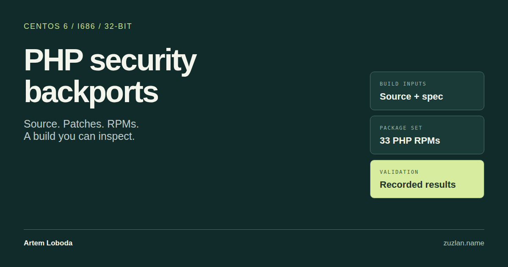

# PHP 5.6.40 security backports for CentOS 6 i686

Review, rebuild and deploy conventional PHP RPMs for an existing CentOS 6.10 32-bit server. This project brings the source, security patches, RPM spec and test results together with signed packages.

**[Download RPMs and source](https://github.com/Zuzlan/php56-centos6-i686-security-backports/releases/latest)** · **[Build report](BUILD_REPORT.md)** · **[Rebuild guide](docs/BUILD.md)**

The patch stack combines Remi's July 2026 security baseline with the October PHP2Shell minimal backport and additional PHP 5.6 lifecycle corrections. It targets the changes associated with [CVE-2026-109618](https://github.com/php/php-src/security/advisories/GHSA-w8hw-w9fx-j79w) and [CVE-2026-109619](https://github.com/php/php-src/security/advisories/GHSA-6wmf-4rv5-p3rp).

**Validation is incomplete.** Full NTS, ZTS and FPM suites retain 55, 48 and 11 failures respectively, plus skips and warnings. The build wrapper returned exit 6. Focused runtime checks passed within the [documented scope](docs/VALIDATION.md).

## Where this helps

- Maintain a legacy Apache 2.2 or FPM installation using conventional `php-*` packages and standard system paths.
- Inspect the exact patches and spec before considering a package change on a CentOS 6 i686 clone.
- Rebuild the RPMs and repeat the supplied regression and runtime checks for your own application environment.

The maintainer reports successful use on a CentOS 6 server with Apache 2.2, VestaCP and legacy PHP applications. That report is separate from the recorded container tests. This is a community backport for an end-of-life stack, not a supported PHP or CentOS release.

## What is included

| Material | Location |
|---|---|
| 33 signed PHP binary RPMs, one signed source RPM and four archived dependency RPMs | [GitHub Releases](https://github.com/Zuzlan/php56-centos6-i686-security-backports/releases/latest) |
| Original PHP source archive, 96 declared patches and packaging inputs | [build-kit/SOURCES](build-kit/SOURCES) |
| Final RPM spec and rebuild scripts | [build-kit](build-kit) |
| Reusable validation scripts and original aggregate results | [scripts/validation](scripts/validation), [VALIDATION.md](docs/VALIDATION.md) |
| Source identities, package metadata, attribution and licenses | [PROVENANCE.md](docs/PROVENANCE.md), [AUTHORS](AUTHORS), [LICENSE](LICENSE) |

The EL6 configuration applies 93 of the 96 declared patches. The remaining three are conditional compatibility patches. The source inputs and spec match the delivered source RPM.

## Start with verification

Download the full archive, source archive, public key, `RELEASE_NOTES.md`, `SHA256SUMS` and `SHA256SUMS.asc` from the latest release. After independently confirming the signing fingerprint, follow [SIGNATURES.md](docs/SIGNATURES.md):

```bash
gpg --show-keys --with-fingerprint RPM-GPG-KEY-artem-loboda-php56
gpg --import RPM-GPG-KEY-artem-loboda-php56
gpg --verify SHA256SUMS.asc SHA256SUMS
sha256sum --check SHA256SUMS
```

Maintainer fingerprint: `B07748530C39253A9E8520F56100DD2FE34B4B53`.

On an isolated clone, follow the [installation and rollback guide](docs/INSTALL_AND_ROLLBACK.md) to select packages and rehearse both directions. It includes a dry-run package transaction. The packages use mysqlnd, so a server using the older `php-mysql` backend needs a separate migration rehearsal.

To inspect or rebuild the source:

```bash
git clone https://github.com/Zuzlan/php56-centos6-i686-security-backports.git
cd php56-centos6-i686-security-backports
python3 scripts/verify_release.py
PHP56_BUILD_IMAGE=i386/centos:6 bash build-kit/build_in_docker.sh "$PWD/build-kit"
```

The build requires a Linux Docker host with 32-bit x86 support, a reviewed local CentOS 6 image and the dependencies described in [BUILD.md](docs/BUILD.md). The wrapper does not pull an image automatically. Rebuild instructions are provided, but bit-for-bit reproducibility has not been established.

## Compatibility to check

Session upload-progress callbacks are disabled. Hardened allocation failures terminate the worker immediately and can bypass shutdown callbacks and cleanup. Test uploads, sessions, database writes and worker recovery with the actual application configuration.

The recorded local tests use EL6 userland on a newer host kernel. They do not establish the behavior of every EL6 kernel, extension or application. The [validation report](docs/VALIDATION.md) retains the failures and untested cases.

## Credits, licensing and support

Maintained by [Artem Loboda](https://www.zuzlan.name). Built on PHP Group work, Remi Collet's packaging and security backports, and [Anton-Barinov/php2shell-patches](https://github.com/Anton-Barinov/php2shell-patches). The upstream minimal fix credits Arnaud Le Blanc and other PHP contributors. Full attribution is in [AUTHORS](AUTHORS) and [THIRD_PARTY_NOTICES.md](THIRD_PARTY_NOTICES.md).

Artem Loboda's original contributions are available under [MIT](LICENSE-MIT). PHP, derived patches and other components retain their existing licenses. The [license scope](LICENSE) also covers the original contributions carried in the signed release snapshots.

Use [Issues](https://github.com/Zuzlan/php56-centos6-i686-security-backports/issues) for build or compatibility reports. Include package identities, the relevant test name and a minimal reproduction. Remove credentials and private server data from diagnostics.
